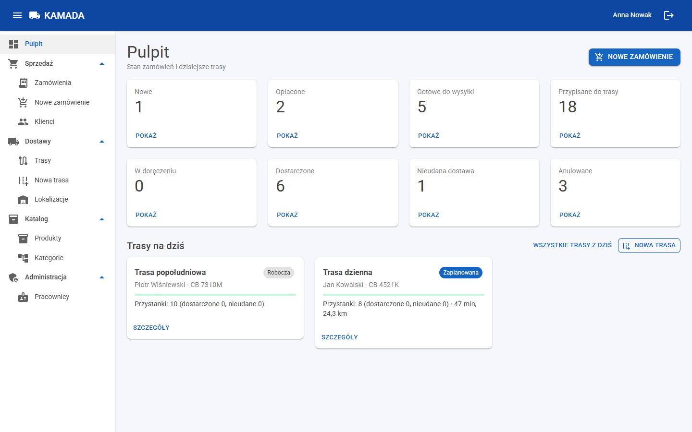
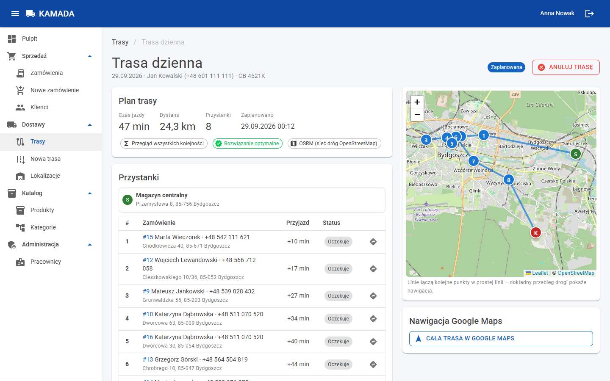
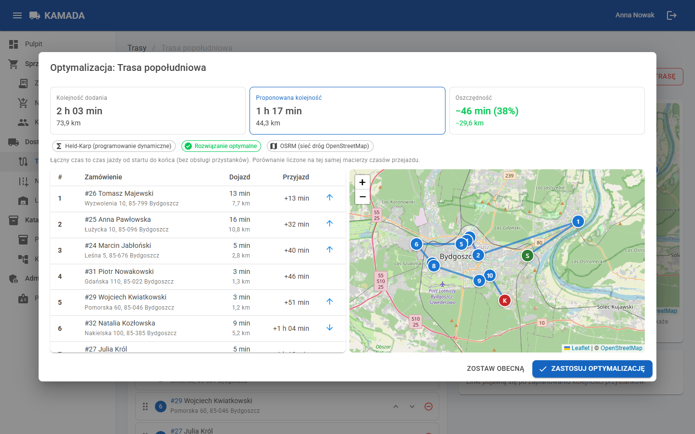
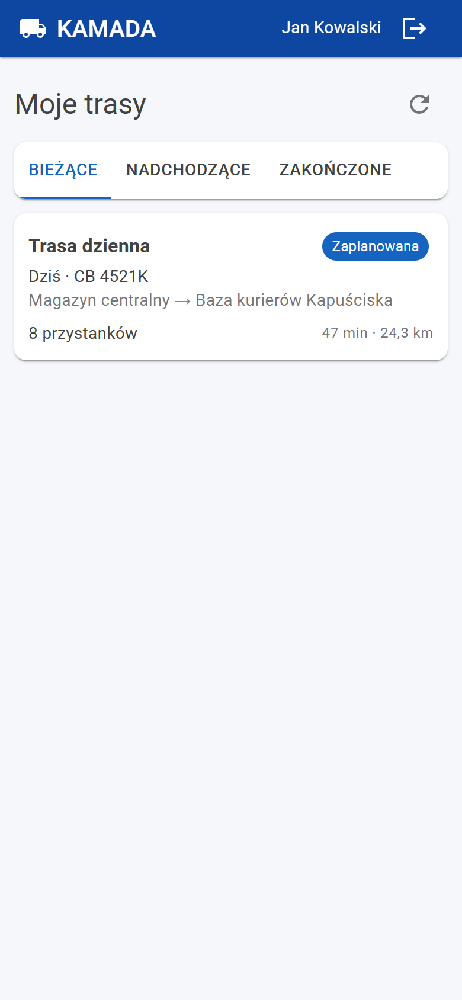
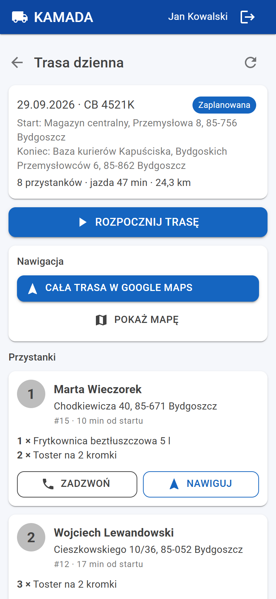
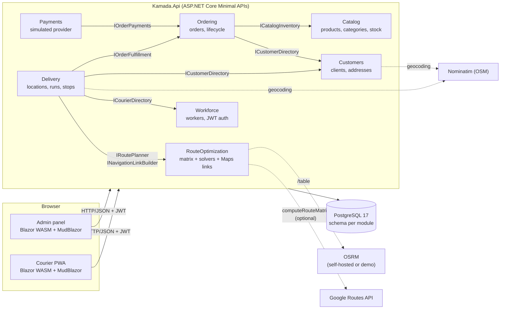
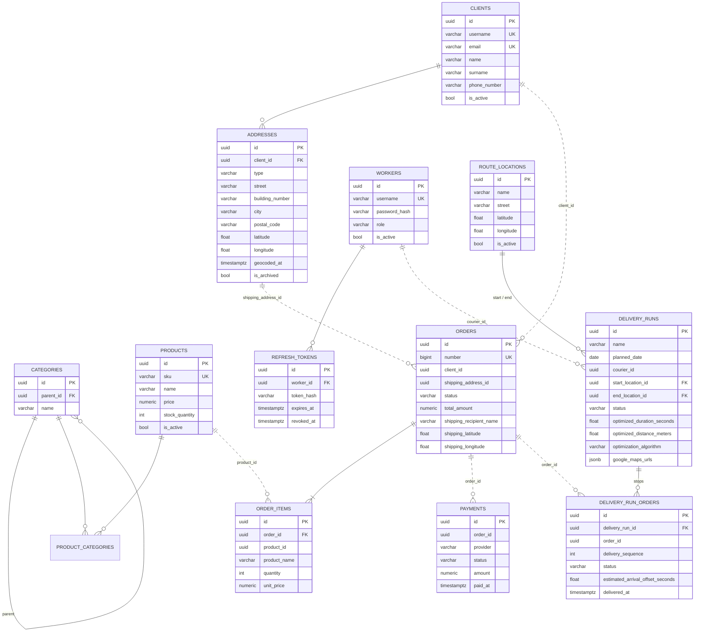

# KAMADA

[](https://github.com/DawidJankowski00/KAMADAv2/actions/workflows/ci.yml)

Order management and courier delivery platform with **route optimization**. It is a .NET 10 modular monolith with
a Blazor WebAssembly admin panel and a Blazor PWA for couriers.

**Admin panel** (desktop):

- **Catalog.** Products with a category tree and multiple categories per product, search, filters and paging.
  Products are deactivated, never deleted.
- **Clients.** Clients and addresses. Addresses are geocoded (OpenStreetMap Nominatim) and shown as a pin on a
  map. When geocoding fails, the admin pins the address by hand.
- **Orders.** New order in a few steps: client → shipping address → products with autocomplete. Stock is
  checked and reserved in one transaction and the total is computed on the server.
- **Payments** through a simulated provider: cash, card (with a decline
  switch), bank transfer with confirmation, and refunds.
- **Route locations.** Warehouses and courier bases where runs start and end.
- **Delivery runs:**
  - pick orders, a courier, a vehicle, the start and the end;
  - **optimize the stop order** and compare it with the current order;
  - reorder by drag and drop;
  - approve the run;
  - see it on a Leaflet map with Google Maps navigation links.
- **Dashboard.** Order counts per status and today's runs.

**Courier app** (phone, installable PWA):

- Own runs only: today, upcoming, completed.
- Stops in the optimized order. Each stop shows the recipient, a `tel:` link, items, notes and the estimated
  arrival time.
- **"Open the whole route in Google Maps"**, split into chained parts for long routes, plus navigation to each
  stop.
- Actions: start the run, mark a stop delivered or failed (with a reason), finish the run.

**Engineering:**

- **Architecture:** modular monolith with enforced boundaries (architecture tests) and one PostgreSQL schema
  per module.
- **Stack:** Minimal APIs, EF Core 10, JWT with rotating refresh tokens, FluentValidation, ProblemDetails,
  Serilog, OpenAPI + Scalar.
- **Tests:** unit, integration (Testcontainers) and architecture tests, plus BenchmarkDotNet for the solvers.
  CI runs on GitHub Actions.
- **Deployment:** one-command startup with Docker Compose and realistic demo data: real addresses in
  the Tricity and Szczecin, orders in every status, runs planned for today and one completed yesterday.

## Screenshots

> Images live in [`docs/images`](docs/images).

| Admin: dashboard | Admin: run planning | Admin: optimization |
|---|---|---|
|  |  |  |

| Courier: my runs | Courier: run details |
|---|---|
|  |  |

## Quick start

Requirements: Docker.

```bash
docker compose up --build
```

| Service | URL |
|---|---|
| Admin panel | http://localhost:5081 |
| Courier app (PWA; use a phone or a narrow window) | http://localhost:5082 |
| API docs (Scalar) | http://localhost:5080/scalar |
| API health | http://localhost:5080/health |

Demo accounts (seeded in the Development environment):

| Role | Username | Password |
|---|---|---|
| Administrator | `admin` | `Admin123!` |
| Courier | `kurier1`, `kurier2`, `kurier3` | `Kurier123!` |

### Demo data

On first start with an empty database, the API seeds a small company delivering in two areas: the Tricity
(Gdańsk, Gdynia, Sopot – Pomorskie) and Szczecin (Zachodniopomorskie). Each area has its own warehouse and
courier base. The data is created through
the real use cases ([ADR 0007](docs/adr/0007-demo-data-through-real-use-cases.md)):

- **Catalog:** 40 products in 5 categories with 11 subcategories. Some products have several categories, low
  stock or no stock, and one is deactivated.
- **Clients:** 25 clients with real, pre-geocoded addresses: 13 in the Tricity and 12 in Szczecin. Five of them have a second shipping
  address. Edge cases: one address without coordinates (pin it on the map), one billing address and one
  deactivated client.
- **Orders:** 36 orders from the last days, split evenly between the two areas, paid by card, cash or transfer, in every status:
  - new and awaiting payment;
  - paid and being packed;
  - ready for delivery;
  - assigned to a run;
  - delivered, failed or cancelled.
- **Runs:**
  - **Trójmiasto – poranna** (`kurier1`): yesterday, completed. Six stops were delivered and one failed; that
    order can be planned again.
  - **Trójmiasto – dzienna** (`kurier1`): today, from the Gdańsk warehouse to the Gdynia base, approved and
    waiting to start.
  - **Szczecin – dzienna** (`kurier2`): today, approved and waiting to start.

  The remaining ready orders are waiting for you to plan a run.

The demo is created relative to the current date. To reset it, recreate the database:

```bash
docker compose down -v
```

### Self-hosted OSRM (optional)

By default, travel times come from the public OSRM demo server. It is fine for development, is throttled to one
request per second, and when it is unavailable planning falls back to straight-line estimates. To run your own
OSRM with a map of four connected voivodeships – Pomorskie, Zachodniopomorskie, Wielkopolskie and Kujawsko-Pomorskie
(about 480 MB from [Geofabrik](https://download.geofabrik.de/europe/poland.html)):

1. Put these lines in `.env` (see [`.env.example`](.env.example)):

   ```dotenv
   OSRM_BASE_URL=http://osrm:5000/
   OSRM_MIN_DELAY=00:00:00
   ```

2. Start the stack with the `osrm` profile:

   ```bash
   docker compose --profile osrm up --build
   ```

The first start downloads the extracts, merges them with `osmium` and preprocesses the result (`deploy/osrm/*.sh`).
This takes about three minutes and under 2 GB of RAM, and the result is kept in the `osrm-data` volume. To use other
voivodeships, set `OSRM_REGIONS` (Geofabrik names, space separated, e.g. `pomorskie zachodniopomorskie`); the map is
prepared again on the next start.

## Running without Docker

Requirements: .NET SDK 10.0.401+ and Docker (for PostgreSQL and the integration tests).

```bash
docker compose up -d postgres
dotnet run --project src/Kamada.Api               # http://localhost:5080
dotnet run --project src/Web/Kamada.AdminPanel    # http://localhost:5081
dotnet run --project src/Web/Kamada.CourierApp    # http://localhost:5082
```

The API applies migrations and seeds demo data on startup (`Database:*` in `appsettings.Development.json`).
Secrets are never committed. In Development the JWT signing key comes from `appsettings.Development.json`.
The optional Google API key goes in user secrets or environment variables:

```bash
dotnet user-secrets --project src/Kamada.Api set "RouteOptimization:Google:ApiKey" "<key>"
```

| Setting | Default | Purpose |
|---|---|---|
| `RouteOptimization:MatrixProvider` | `Osrm` | `Osrm`, `Google` or `Haversine` |
| `RouteOptimization:Osrm:BaseUrl` | public demo server | Self-hosted OSRM: `http://localhost:5000/` |
| `RouteOptimization:Google:ApiKey` | none | Google Routes API (only with provider `Google`) |
| `Geocoding:Provider` | `Nominatim` | `Nominatim`, `Google` or `None` |
| `GoogleMaps:MaxWaypointsPerLink` | `9` | Waypoints per navigation link before splitting |
| `Delivery:ServiceTimePerStop` | `00:03:00` | Time at each stop, used in arrival estimates |

## Tests

```bash
dotnet test --solution Kamada.slnx                        # all tests (Docker required for integration tests)
dotnet test --project tests/Kamada.ArchitectureTests      # module boundaries only
```

- **Unit tests:**
  - order and run state machines, order totals, stock rules;
  - all route solvers: hand-computed optima, plus a property test showing Held–Karp equals brute force on
    random asymmetric matrices;
  - `GoogleMapsUrlBuilder`, including segment splitting;
  - matrix providers against stubbed HTTP;
  - frontend formatting helpers.
- **Integration tests:**
  - **Setup:** the whole API with `WebApplicationFactory` and PostgreSQL in Testcontainers. The matrix provider
    is replaced with Haversine and geocoding with a fake.
  - **Ordering and stock:** an order reserves stock; you cannot order more than is in stock.
  - **Delivery:** an order cannot be in two active runs; the full scenario from creating a run to completing
    it; a courier cannot see another courier's run.
  - **Seed and security:** the demo seed runs on a fresh database; plus auth, rate limiting and health checks.
- **Architecture tests** (NetArchTest plus project references):
  - modules use only each other's `Contracts`;
  - `Domain` has no infrastructure dependencies;
  - module internals are `internal`;
  - frontends reference no modules.

## Architecture

A **modular monolith** ([ADR 0001](docs/adr/0001-modular-monolith.md)): one API host and seven modules. Each
module has an implementation project and a public `Contracts` project. Modules talk to each other only through
contracts: plain interfaces called in-process, sharing one database transaction when needed
([ADR 0002](docs/adr/0002-schema-and-dbcontext-per-module.md)).



```
src/
  Kamada.Api/                      # host: composition, auth, OpenAPI, health checks, rate limiting
  Modules/<Module>/
    Kamada.Modules.<Module>/        # internal: Domain / Application / Infrastructure / Api folders
    Kamada.Modules.<Module>.Contracts/   # public interfaces + DTOs for other modules
  Shared/
    Kamada.Shared.Kernel/           # Result/Error, Entity, GeoPoint
    Kamada.Shared.Infrastructure/   # unit of work, EF interceptors, geocoding, HTTP helpers, seeding
    Kamada.Shared.Contracts/        # HTTP DTOs shared by the API and both frontends
  Web/
    Kamada.Web.Shared/              # shared Blazor library: API client, auth, map, labels
    Kamada.AdminPanel/              # admin SPA
    Kamada.CourierApp/              # courier PWA
tests/                              # unit tests per module, integration tests, architecture tests
benchmarks/Kamada.Benchmarks/       # solver speed and heuristic quality
deploy/                             # nginx config for the SPAs, OSRM data scripts
docs/adr/                           # architecture decision records
```

### Data model

One database, one schema and one `DbContext` per module. Solid lines are foreign keys within a schema. Dashed
lines are references to another module: plain ids with no foreign key across schemas. An order keeps a snapshot
of the recipient and address, so later edits of the client do not change placed orders.



Entities have `created_at` and `updated_at` (set by an EF interceptor) and use `xmin` for optimistic
concurrency. Enums are stored as strings, money as `numeric(10,2)` and timestamps as UTC `timestamptz`.

## Route optimization

A delivery run starts at S (warehouse), visits n stops and ends at E. The order of stops that minimizes total
driving time is a fixed-endpoint travelling-salesman problem. KAMADA splits it into data and search
([ADR 0004](docs/adr/0004-travel-time-matrix-and-local-solver.md)):

1. **One travel-time matrix request:** (n+2)² durations and distances, which may be asymmetric. Providers:
   - **OSRM** (default, OpenStreetMap, no key).
   - **Google Routes API** (`computeRouteMatrix`, only when an API key is configured).
   - **Haversine straight-line estimate:** used by the tests and as an automatic fallback. Plans built on it are
     flagged as approximate.

   Matrices are cached by the set of points.
2. **Local solver** (in memory, chosen by stop count):

   | Stops | Solver | Result |
   |---|---|---|
   | n ≤ 8 | Brute force with branch-and-bound pruning | optimal |
   | n ≤ 15 | Held–Karp dynamic programming, O(n²·2ⁿ) | optimal |
   | n > 15 | Nearest neighbour + 2-opt + Or-opt, time-limited | heuristic, never worse than the input order |

3. **Google Maps links for the courier:** the order is handed over through official
   [Maps URLs](https://developers.google.com/maps/documentation/urls/get-started), split into chained parts when
   there are more than 9 waypoints. Nothing is ever read back from Google Maps: no scraping.

Arrival estimates add driving times along the chosen order plus a configurable service time at each stop.
The admin can preview the optimized order next to the current one, apply it, or set the order by hand. A manual
order is evaluated on the same matrix, so the numbers are comparable.

### Benchmarks

The benchmarks use random asymmetric matrices. They were run with BenchmarkDotNet 0.15.8 on .NET 10.0.12 and an
AMD Ryzen 7 7840HS. Mean time per solve:

| Stops | Brute force | Held–Karp | Heuristic |
|---:|---:|---:|---:|
| 6 | 8.95 μs | 2.17 μs | 1.71 μs |
| 8 | 321 μs | 11.0 μs | 1.33 μs |
| 10 | 16.6 ms | 111 μs | 3.47 μs |
| 12 | – | 1.43 ms | 7.37 μs |
| 15 | – | 15.2 ms | 7.84 μs |
| 25 | – | – | 30.1 μs |
| 50 | – | – | 121 μs |
| 100 | – | – | 555 μs |

Heuristic quality compared with the Held–Karp optimum (100 random matrices per size):

| Stops | Average gap | Worst gap | Optimal found | Gap of unoptimized input order |
|---:|---:|---:|---:|---:|
| 8 | 0.39 % | 8.59 % | 86 / 100 | 71.3 % |
| 10 | 0.53 % | 7.60 % | 80 / 100 | 93.5 % |
| 12 | 0.55 % | 6.27 % | 73 / 100 | 105.1 % |
| 15 | 0.85 % | 12.51 % | 68 / 100 | 127.4 % |

To reproduce:

```bash
dotnet run -c Release --project benchmarks/Kamada.Benchmarks -- --filter '*'
dotnet run -c Release --project benchmarks/Kamada.Benchmarks -- --quality
```

## Design decisions

| ADR | Decision |
|---|---|
| [0001](docs/adr/0001-modular-monolith.md) | Modular monolith with two projects per module |
| [0002](docs/adr/0002-schema-and-dbcontext-per-module.md) | One database, one schema and one `DbContext` per module; cross-module transactions via a shared connection |
| [0003](docs/adr/0003-jwt-with-rotating-refresh-tokens.md) | JWT access tokens with rotating, hashed refresh tokens |
| [0004](docs/adr/0004-travel-time-matrix-and-local-solver.md) | Travel-time matrix plus local solver instead of testing permutations in Google Maps |
| [0005](docs/adr/0005-blazor-wasm-frontends.md) | Two Blazor WebAssembly frontends with a shared UI library |
| [0006](docs/adr/0006-geocoding-never-blocks-saving.md) | Geocoding with Nominatim that never blocks saving an address |
| [0007](docs/adr/0007-demo-data-through-real-use-cases.md) | Demo data seeded through the real use cases |

Smaller decisions are logged in [CLAUDE.md](CLAUDE.md#minor-decisions-log).

## Possible improvements

- **Delivery time windows** per order: TSP with time windows, with arrival estimates as constraints.
- **Vehicle capacity** and **several couriers at once**: split orders between runs, which is the vehicle
  routing problem (VRP), e.g. with OR-Tools.
- **Live courier location**: position tracking on the admin map and ETAs updated from real progress.
- **Customer notifications**: SMS or e-mail when the run starts and when the courier is close.
- **Offline outbox** in the courier PWA: queue stop outcomes without signal and sync them later.
- **Traffic-aware times**: Google Routes with `TRAFFIC_AWARE` for the planned departure time.
- **Proof of delivery**: photo or signature on the stop.
- **Messaging between modules**: domain events through an outbox, once some reactions no longer need to be
  synchronous.
